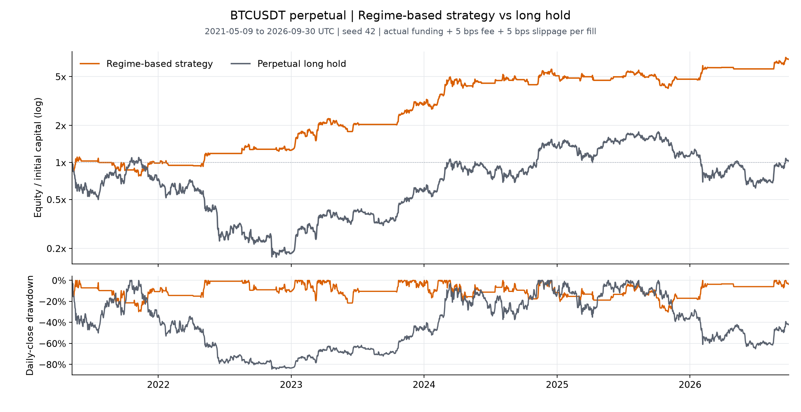

# Bitcoin Auto Trade Research

**시장 국면에 맞는 전략을 적용해 거래 성과를 개선하고자 함.** 은닉 마르코프 모형(HMM)으로 시장을 세 상태로 나누고 국면별 전략을 비교한 오프라인 프로젝트임.

일봉과 펀딩 자료를 수집하고, 과거 자료로 국면을 추정하는 학습 과정과 다음 시가 체결 백테스트를 구현함.

[실험 요약](EXPERIMENTS.md) / [그림과 검산 데이터](results/README.md) / [비교 조건](configs/README.md)

## BTC 국면별 전략 비교

각 국면에서 전체 기간 순수익이 가장 높았던 후보는 상승 국면에서 롱 유지, 횡보 국면에서 MACD 16/35/9와 200일 단순이동평균(SMA200) 롱, 하락 국면에서 MACD 숏이었음. 이 후보들을 단일 포트폴리오로 연결해 실행함.

평가기간은 2021-05-09~2026-09-30 UTC, 초기자금은 10,000 USDT임. 매 체결 수수료와 슬리피지 각각 0.05%(5bps), 실제 펀딩과 마지막 종가 청산 비용을 반영함.

| 전략 | 누적 순수익 | Sharpe | 최대낙폭 |
| --- | ---: | ---: | ---: |
| 국면별 최고수익 후보를 연결한 사후 조합 | +589.92% | 1.157 | 30.14% |
| 같은 무기한선물의 롱 보유 | +2.67% | 0.348 | 84.59% |



국면별 매매 규칙은 전체 기간 성과를 보고 선정했으므로 이후 기간의 성과를 검증한 결과로 해석하지 않음. 보유 기준선도 실제 펀딩을 반영한 무기한선물 롱임.

## 다른 코인에 같은 규칙 적용

BTC에서 정한 입력, HMM 설정과 매매 규칙을 고정하고 각 코인의 과거 자료로 다시 학습함. 코인별 최적화 없이 2022-03-01~2026-09-30의 공통 기간을 비교함. 아래 표도 seed 42 묶음의 결과임.

| 자산 | 누적 순수익 | Sharpe | 최대낙폭 |
| --- | ---: | ---: | ---: |
| ETH | +145.72% | 0.654 | 68.65% |
| SOL | +711.75% | 1.056 | 56.87% |
| XRP | +262.14% | 0.722 | 45.19% |

다른 코인에서도 양의 수익을 냈으나 최대낙폭은 45~69%였음. Sharpe는 일별 수익률의 평균과 표준편차로 계산함.

[ETH·SOL·XRP 각각의 자산곡선과 초기값 민감도](results/README.md#다른-코인-적용)를 함께 제공함.

## 평가 가정과 한계

- 입력은 수익률, 경로 효율성과 taker 매수 불균형(각 120일), 변동성과 평균 펀딩(각 20일)임. 직전 365개 관측으로 학습하고 30일마다 재학습함. 매일 오늘을 포함한 최근 10일의 국면 확률을 평균내고 가장 큰 국면으로 판단함.
- 학습과 정규화는 이전 관측만 사용함. 상승, 횡보, 하락은 수익률 순서로 붙인 상대적 이름임.
- 종가 신호는 다음 시가에 체결함. 진입 비용 차감 후 자산의 1배로 수량을 정해 청산까지 고정하고, 반전은 양쪽 체결 비용을 반영함.
- 펀딩의 실제 부호와 시각을 적용하며 산정 기준 가격이 없으면 해당 일자 시가를 대용함. 유지증거금과 강제청산은 모델링하지 않음.
- Sharpe는 현금일을 포함하고 무위험수익률을 0으로 둠. 최대낙폭은 종가 기준 감소폭의 절댓값임. 미수렴과 거부 기록을 보존하며, 반복 분석한 과거 자료를 미사용 최종 테스트로 해석하지 않음.

## 코드와 실행

[핵심 구현](src/trading/), [실행 방법과 코드 구성](CODE.md), [입력 자료 형식](data/README.md)을 제공함. 관측 변수 계산, HMM 학습, 국면 판단, 매매 신호와 비용·펀딩 백테스트를 포함함.

```powershell
py -3.12 -m venv .venv
.\.venv\Scripts\python.exe -m pip install -e ".[plots]"
.\run-experiment.ps1 -Config configs/btc.toml -CheckOnly
.\run-experiment.ps1 -Config configs/btc.toml
```

실행에는 별도 가격·펀딩 CSV가 필요함. 저장된 대표 성과만 검산하려면 다음 명령을 사용함.

```powershell
python verify_results.py
```
