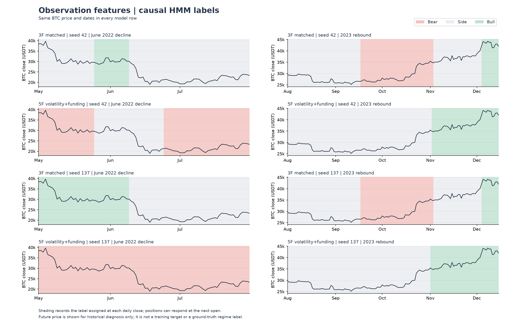

# Bitcoin Auto Trade Research

BTCUSDT 데이터 수집, HMM 국면 추정, 국면별 전략 실행, 결과 검증을 하나의 Python 연구 파이프라인으로 연결한 프로젝트임.

핵심 질문은 시장 국면에 따라 매매 규칙을 바꾸는 것이 비용 차감 후에도 의미가 있는지였음. 이를 확인하기 위해 관측 변수, 상태 지속시간, 전환 방식과 전략 배치를 바꿔 비교함.

| 항목 | 범위 |
| --- | --- |
| 상품 | Binance USD-M BTCUSDT 무기한 선물 |
| 수집 자료 | 2020-01-01~2026-09-30 UTC 일봉과 펀딩 |
| 전략 공통 평가 | 2021-04-30~2026-09-30 UTC, 1,980일 |
| 구현 상태 | 오프라인 수집, 국면 분석, 백테스트, 결과 검증 완료 |
| 실험 기준일 | 2026-10-22 |

[실험별 비교](EXPERIMENTS.md) / [전체 성과와 낙폭](results/README.md) / [다음 작업](ROADMAP.md) / [프로필](../../README.md)

## 구현한 연구 파이프라인

```text
일봉과 펀딩 수집
    -> 데이터 품질과 이용 가능 시각 확인
    -> 관측 변수 계산과 과거 구간 HMM 학습
    -> 현재 종가의 국면 판단과 전략 신호 생성
    -> 다음 시가 체결, 비용과 펀딩 반영
    -> 자산곡선, 주문과 거래 원장, 지표와 검증 자료 생성
```

| 구성 | 처리한 내용 | 남기는 결과 |
| --- | --- | --- |
| 수집과 정제 | 같은 선물 상품의 공개 아카이브 수집. 체크섬, 중복, 결측과 필드별 유효 범위 검사 | 일봉과 펀딩 CSV, 입력 해시와 품질 요약 |
| 국면 추정 | 학습 구간 전용 정규화, 주기적 재학습, 현재 창의 마지막 상태와 확률 사용 | 시점별 국면, 확률, 정규화와 수렴 감사 |
| 전략 연결 | 상승, 횡보, 하락별 매매 규칙 배치. 국면이 바뀌어도 지표 상태를 이어가고 같은 보유 방향은 유지 | 목표 포지션과 시점별 신호 |
| 체결과 자산 | 다음 시가 체결, 비용 차감 후 수량 고정, 반전 비용과 펀딩 시점 처리 | 자산곡선, 주문과 거래 원장 |
| 실험과 검산 | TOML 설정, 단계별 캐시, 두 seed 비교, 입력과 결과 해시 대사 | 성과표, 그림, 재현과 검증 기록 |

일봉 2,465일과 펀딩 이벤트 7,395건을 확보하고 가격, 펀딩과 파생지표 원본 ZIP 2,383개를 SHA256으로 확인함. Top 3 재현에서는 목표, 자산, 주문과 거래 원장 24개 CSV가 원본과 일치함. 당시 작은 파이프라인 통합시험을 포함한 117개 테스트를 통과함.

기존 HMM 프로젝트의 가격 피처와 일부 전략을 재사용하고, 데이터 결합, HMM 학습과 체결 경로를 연구용으로 정리함.

## 국면을 매매로 연결한 방식

기본 입력은 관측창별 로그수익률, 추세 효율성, taker 매수 체결 불균형임. 5변수 후보에는 변동성20과 펀딩평균20을 추가함.

HMM의 세 상태는 학습 구간 수익률 순서로 상승, 횡보, 하락으로 이름을 붙임. 공개 1위 후보의 매매 배치는 다음과 같음.

| 추정 국면 | 매매 규칙 |
| --- | --- |
| 상승 | 롱 보유 |
| 횡보 | EMA10/30 교차와 MA200 진입 필터 |
| 하락 | 현금 보유 |

EMA 지표 상태는 국면 전환 때도 이어감. 학습 상태의 이름은 상대 순위이므로 상승이 절대적인 상승장 정답을 뜻하지 않으며, 하락 라벨도 곧바로 숏 이익을 뜻하지 않음.



검은 선은 BTC 종가, 배경은 각 종가에서 추정한 상태임. 위아래 행은 같은 가격과 날짜이며 3변수와 5변수, seed 42와 137을 비교함. 2022년 급락과 2023년 반등의 사후 진단 예시이며 미래 가격을 학습 정답으로 사용한 그림은 아님.

## 비교한 실험과 얻은 결과

| 비교 | 실제로 바꾼 조건 | 확인한 내용 |
| --- | --- | --- |
| 관측 변수 | 기존 3변수에 변동성과 펀딩 추가, 같은 학습과 전략 조건 유지 | 전체 기간 두 seed Sharpe 개선. 최근 구간에서는 기존 3변수보다 약화 |
| 상태 지속시간 | HMM, Sticky HMM, Poisson HSMM | 짧은 구간 감소가 전체 전환과 관측 설명력 개선으로 이어지지는 않음 |
| 기술적 전략 | 3변수 HMM과 EMA, Momentum, 볼린저 돌파 등의 조합 648개 실행 | 이 3변수 탐색에서는 두 seed 모두 Sharpe 1 이상인 후보가 없었음. 시간순 선정 후보도 최근 부진 |
| 거래비용 | 같은 Williams 신호의 수수료와 슬리피지 조건 변경 | 가격 수익이 남아도 잦은 재진입 비용을 반영하면 누적 손실로 바뀜 |

3변수와 5변수 실험은 192개 백테스트와 48개 라벨 진단을 완료함. 위 실행 수는 각 실험의 규모이며, 서로 합산한 고유 전략 수가 아님. 통제 조건과 수치, 해석은 [실험별 비교](EXPERIMENTS.md)에 정리함.

## 동일 조건의 전략군 Top 3

417개 유효 설정을 같은 관측 변수, 모델 종류, 매매 규칙에 따라 291개 전략군으로 묶음. 각 전략군의 최고 변형을 대표로 남기고 두 seed 중 낮은 일반 Sharpe(Rf=0), 다음 평균 Sharpe 순으로 정렬함.

| 전략군 | 상승 / 횡보 / 하락 | 최저 seed Sharpe | 평균 Sharpe | 순수익, seed 42 / 137 |
| --- | --- | ---: | ---: | ---: |
| 펀딩 5변수 HMM | 롱 / EMA / 현금 | 1.031 | 1.057 | +289.28% / +315.49% |
| 60일 3변수 HMM | EMA / EMA / 현금 | 0.787 | 0.828 | +199.02% / +162.45% |
| 120일 3변수 HMM | 모멘텀90 / EMA / 현금 | 0.776 | 0.837 | +209.39% / +168.46% |

초기자산 10,000 USDT, 편도 수수료 5 bps와 슬리피지 5 bps, 실제 펀딩과 마지막 종가 청산 비용을 반영함. 진입 비용을 뺀 자산의 1배로 BTC 수량을 정하고 청산까지 고정함.


전체 기간을 이미 살펴본 뒤 선정한 사후 탐색 순위임. 1위의 종가 MDD는 seed 42/137 순으로 -26.40% / -25.88%였고, 2025년 이후 Sharpe는 0.106 / 0.400에 그침. 해당 후보의 선택 학습은 1/66회와 4/66회 미수렴했으며 Top 3 전체에서는 7건임. 최근 구간도 미사용 테스트는 아님.

수익률만으로 최종 전략을 확정하지 않았음. 두 seed의 전체와 최근 수익률, MDD, 거래 수와 미수렴은 [전체 결과](results/README.md)에서 같이 확인 가능함.

## 시점과 체결에서 지킨 조건

- 학습 365봉, 재학습 30봉, 상태 이름 60봉, 디코딩 61봉. 고정 seed 42/137 사용
- 학습, scaler와 상태 이름에는 현재 봉 이전 학습 관측만 사용
- 현재 종가에서 끝나는 창의 끝점만 판단에 사용. 전체 시계열의 평활 확률로 과거 신호를 덮어쓰지 않음
- 일반 종가 신호는 다음 시가에 체결. 반전은 청산과 재진입 양쪽 비용을 내고 남은 자산으로 수량을 다시 계산
- 시가와 같은 시각의 펀딩은 매매 전 기존 보유분에 적용. 양의 펀딩은 롱 지급, 숏 수령으로 처리
- 일별 펀딩 집계는 다음 UTC 일자 00:05부터 이용 가능하다고 가정. 거래소 실제 공개 시각을 확인한 값은 아님
- 펀딩 이벤트의 mark가 없으면 해당 일자 시가를 대용. 일중 자산 하한 검사는 유지하되 거래소 마진과 청산가는 모형화하지 않음

## 남은 작업

현재 완성 범위는 일봉 기반 오프라인 연구임. 다음 단계는 오더북 수집과 재생, 실제 체결 제약을 포함한 paper 실행임.

- [ ] 기존 일봉 신호의 체결 개선과 별도 호가 신호 연구 중 목적 결정
- [ ] 스냅샷과 증분 이벤트로 호가 복원, 시퀀스 누락과 재연결 처리
- [ ] 지연과 부분 체결 가정을 기록하고 가상 주문, 포지션과 자산 대사

오더북, paper, testnet, live 주문 경로는 구현 전임. 완료 기준은 [로드맵](ROADMAP.md)에 정리함.

## 공개 자료

[설정 TOML](configs/README.md), [성과 CSV](results/metrics.csv), [자산곡선 CSV](results/equity.csv), [선정 근거](results/ranking_snapshot.json), [재현 기록](results/reproduction.json), [당시 검증 기록](results/verification.json)을 보관함.

공개 파일의 원본 출처와 해시는 [PUBLICATION.json](PUBLICATION.json)에 기록함. 실행 코드, 원시 데이터, 전체 보고서와 캐시는 로컬 연구 프로젝트에 보관 중이며, 이 프로필 저장소의 설정 파일만으로 실험 실행은 불가함.
