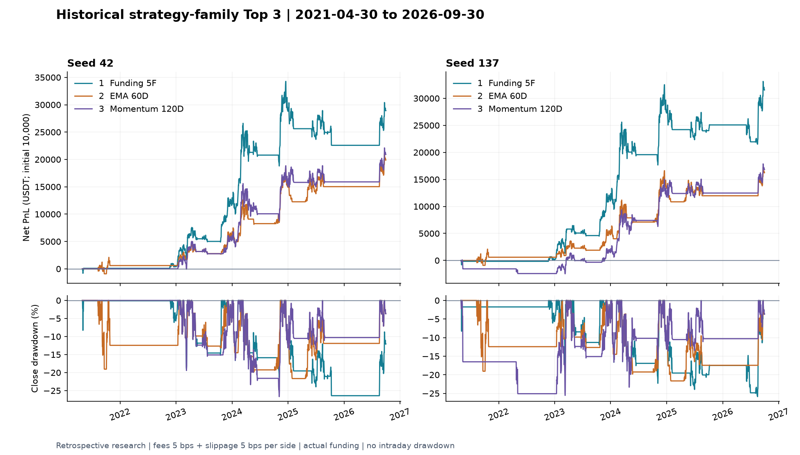
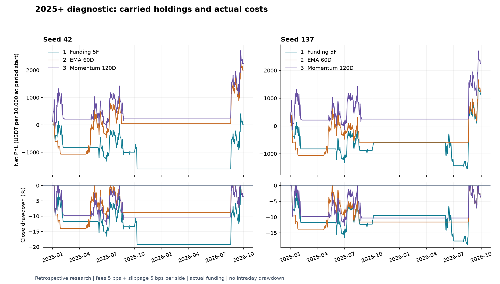

# 전략 비교 결과

실험과 재현 기준일: 2026-10-22

이미 반복해서 살펴본 과거 기간에서 고른 사후 탐색 결과임. 미사용 테스트 성과가 아니며, 두 seed와 최근 구간 성과, 미수렴 기록을 함께 남김.

## 비교 조건

| 항목 | 조건 |
| --- | --- |
| 대상과 기간 | Binance USD-M BTCUSDT 무기한 / 2021-04-30~2026-09-30 UTC, 1,980일 |
| 비교 범위 | 호환 보고서 19개, 중복과 별칭을 합친 유효 설정 417개, 전략군 291개 |
| 순위 | 고정 seed 42/137 중 낮은 일반 Sharpe(Rf=0), 다음 평균 Sharpe |
| 전략군 | 같은 관측, 모델 종류, 매매 규칙을 묶고 학습과 전환 변형 중 최고 설정을 대표로 선택 |
| 자산과 수량 | 초기 10,000 USDT, 진입 비용 차감 후 자산 1배의 BTC 수량을 청산까지 고정 |
| 체결과 비용 | 종가 신호 → 다음 시가 / 편도 수수료 5 bps + 슬리피지 5 bps / 마지막 종가 비용 포함 청산 |
| 펀딩 | 실제 이벤트의 부호와 시각 반영. mark가 없으면 해당 일자 시가 대용 |
| 모델 | 3상태 HMM, 대각 공분산, 학습365, 재학습30, naming60, decode61봉, EM 최대100회, 재시작10 |

완료 보고서 중 평가 날짜나 비용 등이 다른 7개는 제외함. 전기간 롱 기준선과 장중 스톱 진입을 쓰는 Williams 전략도 공통 순위에서 제외함. Top 3는 모두 하락 국면에서 현금을 보유하며 숏은 사용하지 않음.

학습, 정규화, 상태 이름에는 현재 봉 이전의 학습 관측만 사용함. 현재 종가에서 끝나는 창의 마지막 상태로 판단함. 청산가와 거래소 마진은 모형화하지 않았고, 기존 엔진의 일중 자산 하한 검사는 유지함.

## 선정 전략

| 순위 | 설정 | 관측 변수 | 상승 / 횡보 / 하락 | 최저 / 평균 Sharpe |
| --- | --- | --- | --- | ---: |
| 1 | [펀딩 5변수](../configs/top3_01_funding.toml) | 수익120, 효율120, taker120, 변동성20, 펀딩평균20 | 롱 / EMA / 현금 | 1.031 / 1.057 |
| 2 | [60일 3변수](../configs/top3_02_ema60.toml) | 수익60, 효율60, taker60 | EMA / EMA / 현금 | 0.787 / 0.828 |
| 3 | [120일 3변수](../configs/top3_03_momentum120.toml) | 수익120, 효율120, taker120 | 모멘텀90 / EMA / 현금 | 0.776 / 0.837 |

수익은 로그수익률, taker는 매수 체결 불균형임. EMA는 10/30 교차와 MA200 진입 필터를 사용하며 국면 전환 때 내부 지표 상태를 이어감. 모멘텀90은 90일 수익률이 양수면 롱, 그 외에는 현금 보유.

## 전체 기간, 두 seed 비교

| 순위 | seed | 누적 순수익 | Sharpe | 종가 MDD | 거래당 순수익 | 완료 거래 | 선택 학습 미수렴 |
| --- | ---: | ---: | ---: | ---: | ---: | ---: | --- |
| 1 | 42 | +289.28% | 1.031 | -26.40% | +1,133.57 bps | 16 | 1/66 |
| 1 | 137 | +315.49% | 1.082 | -25.88% | +1,059.16 bps | 18 | 4/66 |
| 2 | 42 | +199.02% | 0.869 | -21.65% | +660.38 bps | 19 | 0/68 |
| 2 | 137 | +162.45% | 0.787 | -21.65% | +560.51 bps | 20 | 0/68 |
| 3 | 42 | +209.39% | 0.897 | -26.66% | +1,514.82 bps | 9 | 0/66 |
| 3 | 137 | +168.46% | 0.776 | -25.56% | +933.16 bps | 14 | 2/66 |

미수렴은 최종 선택 학습의 기록이며 재시작 전체의 경고 횟수와 구분함. 당시 재현의 손익 거부와 실패는 0건이었고, 선택 학습 미수렴 7건은 그대로 남김. 학습 재실행 여부와 관계없이 기존 미수렴을 포함함.

## 최근 구간, 2025-01-01~2026-09-30

| 순위 | seed | 순수익 | Sharpe | 종가 MDD |
| --- | ---: | ---: | ---: | ---: |
| 1 | 42 | +0.26% | 0.106 | -19.26% |
| 1 | 137 | +11.42% | 0.400 | -18.70% |
| 2 | 42 | +20.01% | 0.653 | -14.04% |
| 2 | 137 | +12.46% | 0.458 | -14.04% |
| 3 | 42 | +22.45% | 0.673 | -12.79% |
| 3 | 137 | +22.45% | 0.673 | -12.79% |

전체 1위의 최근 성과는 약했음. 최근 구간도 이미 살펴본 데이터에 대한 진단임. 구간 시작 직전 자산과 기존 보유분을 이어받으며 임의 청산이나 재진입은 만들지 않음. 그림은 구간 시작 자산을 10,000으로 정규화한 표시이며 별도 신규 포트폴리오가 아님.

## 지표와 한계

- Sharpe: 첫날과 현금 보유일을 포함한 일별 순자산 수익률의 평균 / 표본 표준편차 × sqrt(365.25), Rf=0. BTC 대비 Information Ratio와 구분함.
- MDD: 초기 또는 구간 시작 자산을 포함한 종가 고점 대비 최대 낙폭임. 장중 최대 낙폭은 아님.
- 거래당 bps: 완료 거래의 `net_pnl / entry_equity × 10000` 산술평균임. 100 bps=1%.
- 펀딩: 양수는 롱 지급, 숏 수령이며 음수는 반대임. 시가와 같은 시각의 펀딩은 매매 전 기존 보유분에 적용함.
- 선정 편향: 같은 기간에서 변형을 탐색하고 대표를 골랐으므로 낮은 seed Sharpe로 정렬해도 미사용 테스트를 대체하지 못함.
- 실행 범위: 과거 일봉의 다음 시가 체결이며 실제 호가, 지연, 부분 체결을 재현한 결과는 아님.

## 근거 파일

| 파일 | 내용 |
| --- | --- |
| [metrics.csv](metrics.csv) | 3전략 × 2seed의 전체와 최근 수익률/Sharpe/MDD, 비용, 펀딩, 미수렴 |
| [equity.csv](equity.csv) | 동일 1,980일의 두 seed USDT 종가 자산 |
| [ranking_snapshot.json](ranking_snapshot.json) | 전략군 순위와 묶기 전 개별 설정 순위, 별칭, 출처 |
| [reproduction.json](reproduction.json) | 2026-10-22 설정 검사, 실행, 원장 24개 SHA256 대사 |
| [verification.json](verification.json) | 당시 저장 자산과 원장 검산, 117개 테스트 통과 기록 |
| [manifest.json](manifest.json) | 당시 입력, 소스, 설정, 의존성, 공개 결과 해시 |
| [PUBLICATION.json](../PUBLICATION.json) | 게시 사본의 원본 경로와 SHA256 |

CSV, JSON, PNG, TOML은 원본 바이트 그대로 복사함. JSON의 `reports/...`, `src/...`, `configs/...` 등은 원래 연구 프로젝트 기준의 출처 경로이며 이 프로필 저장소의 웹 링크가 아님. 과거 manifest의 `prepared_locally_not_uploaded`도 2026-10-22 당시 상태를 보존한 값임. 게시 범위는 PUBLICATION.json에서 확인 가능함. 실행 코드와 원시 데이터는 프로필 저장소에 미포함.

당시 재현에서는 확률 캐시6회, 매매 캐시6회를 재사용했고 신규 학습, 캐시 miss, 손익 실패는 0건이었음. 이번에는 문서만 정리함. 새 학습, 백테스트, 전체 테스트는 수행하지 않음.

[연구 개요](../README.md) / [다음 작업](../ROADMAP.md)
