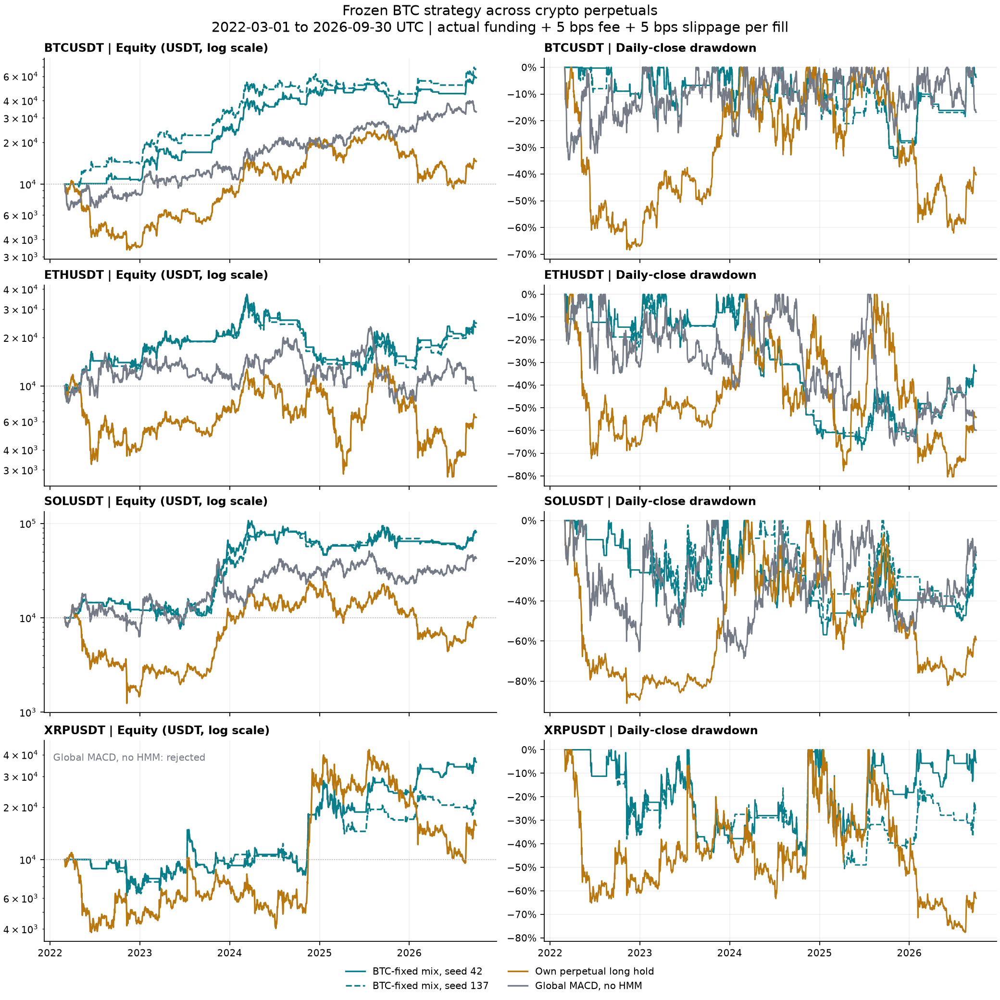

# 그림과 검산 데이터

[프로젝트 개요](../README.md) / [실험 요약](../EXPERIMENTS.md)

## BTC 국면별 전략

2021-05-09~2026-09-30의 비교임. 주황은 국면별 사후 조합(seed 42), 회색은 무기한선물 롱 보유임. 위는 초기자금 대비 자산 배수의 로그축, 아래는 종가 고점 대비 낙폭임. 실제 펀딩과 체결당 수수료 및 슬리피지 각각 0.05%를 반영함.

## 다른 코인 적용

2022-03-01~2026-09-30의 공통 기간임. 청록 실선과 점선은 고정 전략의 seed 42와 137, 황색은 해당 선물 롱 보유, 회색은 HMM 없는 MACD임. XRP MACD는 두 seed 모두 자산 고갈 가능성으로 거부돼 곡선을 표시하지 않음.

| 자산 | 순수익, seed 42 / 137 | Sharpe, seed 42 / 137 |
| --- | ---: | ---: |
| BTC 대조군 | +485.34% / +569.86% | 1.275 / 1.325 |
| ETH | +145.72% / +132.38% | 0.654 / 0.637 |
| SOL | +711.75% / +691.15% | 1.056 / 1.053 |
| XRP | +262.14% / +108.13% | 0.722 / 0.535 |

## 데이터 정의

- [summary.csv](summary.csv): 대표 성과 15개 경로임. `case`, `symbol`, `seed`, `start`, `end`, `total_return`, `sharpe`, `max_drawdown`을 기록함.
- [equity.csv](equity.csv): 첫 열 `date`는 UTC 날짜이며, 나머지 열은 `summary.csv`의 `case`와 같은 이름의 일별 순자산임. 각 경로의 평가기간 밖은 공란임.
- 각 경로의 초기자금은 10,000 USDT임. 첫 일별 수익률은 `첫 종가 자산 / 10,000 - 1`이며, 이후에는 직전 종가 자산을 기준으로 계산함. 현금 대기일도 포함함.
- `total_return`과 `max_drawdown`은 소수비율이며 낙폭은 음수로 기록함. 본문에서는 백분율과 감소폭의 절댓값으로 표시함. Sharpe는 일별 평균수익률을 표본 표준편차로 나누고 √365.25를 곱하며 무위험수익률은 0임.

검산 데이터는 본문의 대표 경로, seed 137 민감도, 보유 기준선과 2025년 선정 조합을 담음. 그림의 모든 보조 전략과 전체 거래 원장을 포함하지는 않음.

프로젝트 폴더에서 `python verify_results.py`를 실행하면 두 CSV의 기간과 일수, 수익률, Sharpe와 최대낙폭을 대조할 수 있음. 원시 가격과 펀딩에서 전략을 다시 실행하는 코드는 아님.
